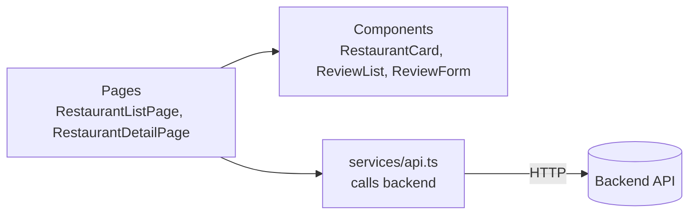
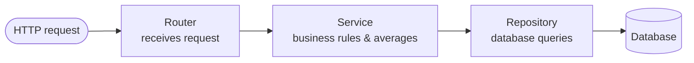

# Petuk

A community-driven restaurant discovery and review platform for Bangladesh: browse restaurants, view menus, and rate eateries on taste, atmosphere, cleanliness, price, and service. Built as a REST API with FastAPI and a React frontend, deployed on Vercel.

> **Status:** MVP in progress. Restaurant and review CRUD endpoints (`/api/v1/restaurants`, `/api/v1/restaurants/{id}/reviews`) and basic React views work locally with SQLite; user accounts, authentication, admin roles, and menus are planned for the Beta.

## Features

**MVP** (demo before mid-term)
- Create, list, view, update, and delete restaurants through a REST API (`/api/v1/restaurants`)
- Submit and view reviews with 5 rating dimensions (taste, atmosphere, cleanliness, price, service) and comments
- Automatic calculation of category rating averages and overall scores
- Input validation with standard FastAPI error messages
- Interactive API documentation at `/api/docs`

**Beta** (demo before final)
- Sign up, log in, log out (JWT access token + refresh token cookie)
- User roles: `customer` and `admin`
- Review ownership: customers can only edit or delete their own reviews (one review per restaurant)
- Admin controls: manage restaurants and menus, delete flagged or abusive reviews
- Restaurant menus: view dishes and prices (BDT)
- Security: Argon2 password hashing, 15-minute login lockout after 5 failed attempts, secure HTTP headers

## Tech stack

| Part | Choice |
|---|---|
| Backend | Python 3.10+, FastAPI, SQLModel |
| Database | Supabase PostgreSQL (production), SQLite (local) |
| Frontend | React + TypeScript + Vite |
| Hosting | Vercel (frontend and backend in one project) |
| Beta extras | Alembic (migrations), PyJWT, pwdlib (Argon2) |

## Documentation

| Doc | What it covers |
|---|---|
| [PRD — Product Requirements Document](docs/01-prd.md) | Goals, target users, features, user stories, scope |
| [SRS — Software Requirements Specification](docs/02-srs.md) | Functional requirements, permissions matrix, validation rules, acceptance criteria |
| [TDD — Technical Design Document](docs/03-tdd.md) | System architecture, sequence flows, data models, REST API endpoints, security |

## Project structure

```
backend/    FastAPI app (routes under /api)
frontend/   Vite + React + TypeScript
docs/       PRD, SRS, TDD (requirements, specification, technical design)
vercel.json Vercel setup: /api/* goes to backend, everything else to frontend
AGENTS.md   Branch, commit and PR conventions
```

## How it works

### Frontend



A page handles routing and data fetching, components render the UI elements, and `services/api.ts` is the single point of communication with the backend.

### Backend



Each layer has a distinct responsibility: the router parses HTTP payloads, the service computes business rules (such as rating score averages and one-review constraints), and the repository queries the database.

## Requirements

- [Python](https://www.python.org/downloads/) 3.10+
- [Node.js](https://nodejs.org/) 22+

> On macOS/Linux, use `python3` instead of `python`.

## Run locally

You need two terminals: one for the backend and one for the frontend. Data is stored locally in SQLite at `backend/petuk.db`, which is created automatically on the first run and ignored by Git.

### First time (initial setup)

Run this once after cloning the repo.

**Backend** (terminal 1):

```bash
cd backend
python -m venv .venv
.venv\Scripts\Activate.ps1      # macOS/Linux: source .venv/bin/activate
pip install -r requirements.txt
fastapi dev main.py
```

**Frontend** (terminal 2):

```bash
cd frontend
npm install
npm run dev
```

### Running again (after the initial setup)

**Backend** (terminal 1):

```bash
cd backend
.venv\Scripts\Activate.ps1      # macOS/Linux: source .venv/bin/activate
fastapi dev main.py
```

**Frontend** (terminal 2):

```bash
cd frontend
npm run dev
```

Open http://localhost:5173. Vite proxies `/api` calls to the backend on port 8000. Interactive Swagger API docs are available at http://localhost:8000/docs.

To test with the local Vercel CLI runner:

```bash
npm install -g vercel
vercel dev -L
```

> **Reset local data:** Stop the backend and delete `backend/petuk.db`.

## Environment variables

Locally, no environment variables are required; the system falls back to `backend/petuk.db`. In production on Vercel, the app connects to Supabase PostgreSQL. Configure variables in Vercel under **Project → Settings → Environment Variables**:

| Variable | Needed for | Notes |
|---|---|---|
| `DATABASE_URL` | MVP (production) | Supabase transaction pooler URL (port `6543`), e.g. `postgresql+psycopg://postgres.<ref>:<password>@aws-0-<region>.pooler.supabase.com:6543/postgres`. Unset locally to default to SQLite. |
| `POSTGRES_URL` | MVP (production) | Populated automatically by the Supabase integration on Vercel if configured. |
| `JWT_SECRET` | Beta | Random secret key, generated via: `python -c "import secrets; print(secrets.token_urlsafe(48))"` |
| `ACCESS_TOKEN_MINUTES` | Beta | Default `15` |
| `REFRESH_TOKEN_DAYS` | Beta | Default `7` |

Never commit secrets or `.env` files.

## Deploy to Vercel

1. Push your changes to GitHub.
2. Visit https://vercel.com/new, import the repository, and click **Deploy**. Keep **Root Directory** as `./`.

Every push to the `main` branch triggers an automated deployment.

## Troubleshooting

- **"Running scripts is disabled" in PowerShell:** Run `Set-ExecutionPolicy -Scope CurrentUser RemoteSigned`.
- **`fastapi` not found:** Activate your virtual environment first (`.venv\Scripts\Activate.ps1` or `source .venv/bin/activate`).
- **`ModuleNotFoundError: sqlmodel`:** Run `pip install -r requirements.txt` within the active virtual environment.
- **Database corrupted or schema outdated:** Stop the backend and delete `backend/petuk.db`.
- **`Request failed: 500`:** Ensure the FastAPI backend server is actively running on port 8000.
- **App at localhost:8000 shows outdated frontend code:** Delete `frontend/dist`.
- **Vercel build fails:** Check **Build Logs** in your Vercel project and verify that `npm run build` succeeds locally in `frontend/`.