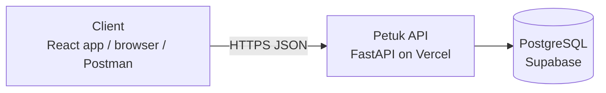
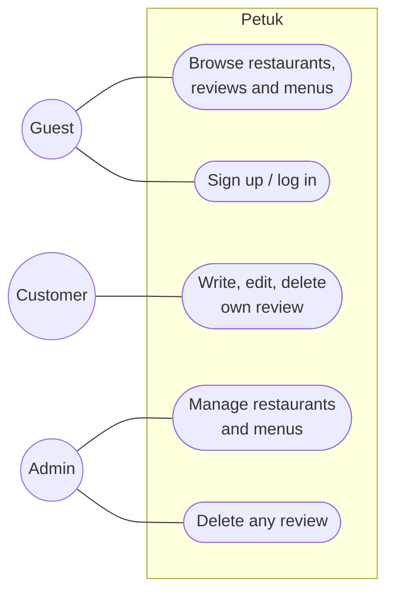
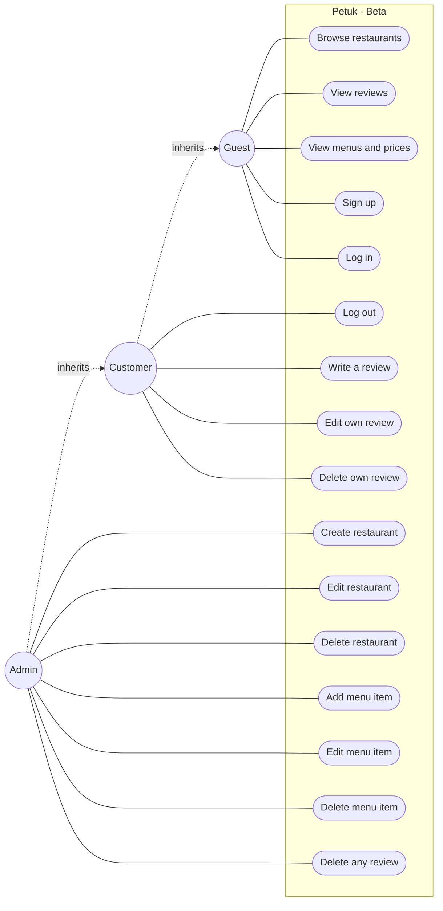
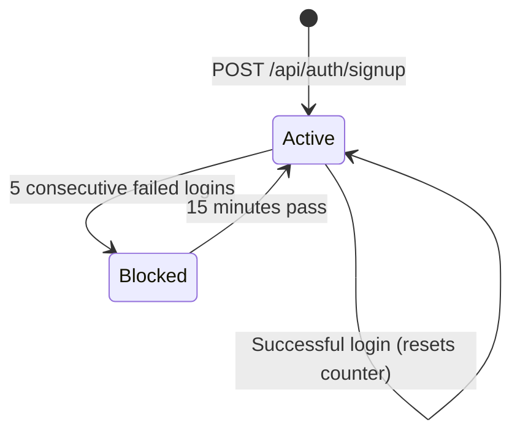

# Software Requirements Specification (SRS) — Petuk

| Field | Value |
|---|---|
| Product | Petuk |
| Version | MVP + Beta |
| Releases | MVP — Mid-term, Beta — Final |
| Status | Draft |
| Related docs | [Product Requirements Document (PRD)](01-prd.md), [Technical Design Document (TDD)](03-tdd.md) |

Every requirement has a **Release** column: **MVP** is built for the mid-term, **Beta** is added for the final.

**Documents in this set**

| Short form | Full form | Purpose | File |
|---|---|---|---|
| PRD | Product Requirements Document | What we build and why | [01-prd.md](01-prd.md) |
| SRS | Software Requirements Specification | Exact requirements and permissions (this document) | [02-srs.md](02-srs.md) |
| TDD | Technical Design Document | How we build it: architecture, data model, API | [03-tdd.md](03-tdd.md) |

## 1. Introduction

### 1.1 Purpose:
This document lists the requirements for Petuk, a restaurant discovery and review platform for Bangladesh, deployed on Vercel.

### 1.2 Scope:
- **MVP:** a client can add, view, edit and delete restaurants and reviews over HTTP. There are no accounts; everyone shares the same data.
- **Beta:** customers sign up and log in, reviews belong to their author, an admin manages restaurants and menus, and restaurants show menu items with prices.
- Out of scope: see [PRD, section 4](01-prd.md#4-scope).

### 1.3 Definitions:

| Term | Meaning |
|---|---|
| CRUD | Create, Read, Update, Delete |
| REST | API style where resources (like `restaurants`) are used with HTTP methods (GET, POST, PATCH, DELETE) |
| Restaurant | A place to eat, with a name, area, cuisine and address |
| Review | A customer's feedback on a restaurant: five ratings and an optional comment |
| Rating | A whole number from 1 (worst) to 5 (best) for taste, atmosphere, cleanliness, price (value for money) or service |
| Menu item | (Beta) A dish of a restaurant with a name and a price in BDT |
| Role | What a logged-in person is allowed to do: `customer` or `admin` |
| Client | Anything that calls the API: the React frontend, `/api/docs`, Postman |

## 2. Overall description

### 2.1 System context:

### 2.2 Users and roles:

| Role | Release | Description |
|---|---|---|
| Anonymous client | MVP | Anyone who can reach the API; full access to all restaurants and reviews |
| Guest | Beta | Not logged in; can read restaurants, reviews and menus, sign up and log in |
| Customer | Beta | Logged in; writes reviews and manages their own reviews |
| Admin | Beta | A customer with extra rights: manages restaurants and menus, deletes any review |

`customer` and `admin` are stored on the user account. Every admin can do everything a customer can.

### 2.3 Use cases:
#### MVP

#### Beta

Customers and admins can also do everything a guest can. In the MVP there are no accounts, so every client acts like a customer and an admin at once.

### 2.4 Constraints:

- C-1: Runs on Vercel serverless functions (no local disk that survives between requests).
- C-2: Backend in Python with FastAPI.
- C-3: All API routes start with `/api`.
- C-4: Requests and responses use JSON.
- C-5: The database is Supabase PostgreSQL.
- C-6: (Beta) Login is built in our own API (no third-party login providers).

### 2.5 Assumptions:

- A-1: A hosted database is available to the Vercel project through an environment variable.
- A-2: The app is used for demos and class work, so traffic is low.
- A-3: (Beta) The first admin is set manually in the database.
- A-4: (Beta) MVP data is demo data and may be removed when reviews get an author.
- A-5: The "Could" items in the PRD (React pages, profile page, restaurant owner role) are only specified here if they get built.

## 3. Functional requirements 

## 3.1 MVP + Beta:

| ID | Requirement | Release |
|---|---|---|
| FR-01 | The system shall create a restaurant from a JSON body with `name` and `area` (required), `cuisine` and `address` (optional). | MVP |
| FR-02 | The system shall list restaurants, newest first, with `offset` and `limit` query parameters. | MVP |
| FR-03 | The system shall return one restaurant by ID, including its average rating for each of the five categories and an overall average (empty if it has no reviews). | MVP |
| FR-04 | The system shall update any field of an existing restaurant. Fields not sent stay unchanged. | MVP |
| FR-05 | The system shall delete a restaurant by ID, together with its reviews and menu items. | MVP |
| FR-06 | The system shall create a review for a restaurant with five ratings (`taste`, `atmosphere`, `cleanliness`, `price`, `service`) and an optional `comment`. | MVP |
| FR-07 | The system shall list the reviews of a restaurant, newest first, with `offset` and `limit`. | MVP |
| FR-08 | The system shall update the ratings or comment of an existing review. | MVP |
| FR-09 | The system shall delete a review by ID. | MVP |
| FR-10 | The system shall reject invalid input with `422` and a message saying which field is wrong, and return `404` when a restaurant or review does not exist. | MVP |
| FR-11 | The system shall provide a health check at `GET /api/health` returning `{"status": "ok"}`, and interactive API docs at `/api/docs`. | MVP |
| FR-12 | The system shall let a guest sign up with `email`, `name` and `password`. A duplicate email returns `409`. New users get the role `customer`. | Beta |
| FR-13 | The system shall let a user log in with email and password and log out. A wrong email or password returns `401`. | Beta |
| FR-14 | Creating, editing or deleting anything (restaurants, reviews, menu items) shall require login; otherwise the system returns `401`. Reading stays public. | Beta |
| FR-15 | A review shall belong to the customer who wrote it. A customer can write only one review per restaurant (`409` if they try again) and can edit or delete only their own reviews (`403` otherwise). | Beta |
| FR-16 | Only an admin shall be able to create, edit or delete restaurants and menu items. Anyone else gets `403`. | Beta |
| FR-17 | An admin shall be able to delete any review. | Beta |
| FR-18 | Each restaurant shall have menu items with a `name` and a `price`. Anyone can view them; only an admin can add, edit or delete them. | Beta |
| FR-19 | After 5 failed logins in a row for an email, the system shall block logins for that account for 15 minutes and return `429`. A successful login resets the counter. | Beta |

### 3.2 Validation rules:

| Field | Rule | Release |
|---|---|---|
| `name` (restaurant, menu item, user), `area` | Required, 1–100 characters after trimming spaces | MVP |
| `taste`, `atmosphere`, `cleanliness`, `price`, `service` | Required on create, whole number 1–5 | MVP |
| `comment` | Optional, max 500 characters | MVP |
| `offset`, `limit` | `offset` is 0 or more; `limit` is 1–50 (default 20) | MVP |
| `email`, `password` | `email` is a valid email, stored in lowercase; `password` is 8–128 characters | Beta |
| menu item `price` | Required, number 0 or more (BDT) | Beta |

### 3.3 Sates:

### 3.4 Permission matrix:

In the **MVP** there are no accounts, so every action is open to everyone. The matrix below is for the **Beta**.

| Action | Guest | Customer | Admin |
|---|---|---|---|
| View restaurants, reviews and menus | Yes | Yes | Yes |
| Sign up, log in | Yes | — | — |
| Log out | No (`401`) | Yes | Yes |
| Write a review | No (`401`) | Yes | Yes |
| Edit or delete own review | No (`401`) | Yes | Yes |
| Edit another person's review | No (`401`) | No (`403`) | No (`403`) |
| Delete another person's review | No (`401`) | No (`403`) | Yes |
| Add, edit or delete restaurants | No (`401`) | No (`403`) | Yes |
| Add, edit or delete menu items | No (`401`) | No (`403`) | Yes |

### 3.5 Status codes:

| Case | Code | Release |
| --- | --- | --- |
| Resource created | `201 Created` | MVP|
| Read or update succeeded | `200 OK` | MVP|
| Deleted / logged out | `204 No Content` | MVP|
| Validation failed (e.g., missing required fields) | `422 Unprocessable Content` | MVP|
| Resource not found (restaurant or review does not exist) | `404 Not Found` | MVP|
| Unexpected server error | `500 Internal Server Error` | MVP|
| Missing or invalid login | `401 Unauthorized` | Beta|
| Logged in but role not allowed, or editing another user's review | `403 Forbidden` | Beta|
| Duplicate email on signup, or multiple reviews on one restaurant | `409 Conflict` | Beta|
| Too many failed logins (5 attempts) | `429 Too Many Requests` | Beta|

## 4. Non-functional requirements 

| ID | Category | Requirement | Release |
|---|---|---|---|
| NFR-01 | Persistence | Data is stored in a database and is not lost on redeploy or restart. | MVP |
| NFR-02 | Availability | The production API is reachable on the Vercel URL during the semester. | MVP |
| NFR-03 | Performance | 95% of requests answer in under 500 ms (excluding a cold start). | MVP |
| NFR-04 | Security | All traffic uses HTTPS (provided by Vercel). | MVP |
| NFR-05 | Security | Database credentials and secrets are stored only in environment variables, never in Git. | MVP |
| NFR-06 | Security | Error responses do not expose internal details such as stack traces or database errors. | MVP |
| NFR-07 | Usability (API) | Every endpoint is listed in `/api/docs` with its request and response format. | MVP |
| NFR-08 | Security | Passwords are stored hashed and are never logged or returned in plain text. | Beta |
| NFR-09 | Security | Permissions are checked on the server for every request; hiding a button in the frontend is never the only protection. | Beta |

## 5. Acceptance criteria

### MVP

**AC-01 Create restaurant (FR-01, FR-10)**
* Given a valid body `{"name": "Kacchi Bhai", "area": "Mirpur"}`
* When the client sends `POST /api/restaurants`
* Then the response is `201` with the restaurant details.
* When the client sends the request without the `name` field, the response is `422`.

**AC-02 List and view restaurants (FR-02, FR-03, FR-10)**
* Given 30 restaurants exist
* When the client sends `GET /api/restaurants?limit=10&offset=0`, the response is `200` with 10 restaurants, newest first.
* When the client sends `GET /api/restaurants/{id}` for a valid ID, the response is `200` including average category ratings.
* When the client requests an ID that does not exist, the response is `404`.

**AC-03 Create review (FR-06, FR-10)**
* Given a valid body with `taste: 5`, `atmosphere: 4`, `cleanliness: 4`, `price: 5`, `service: 5` and a `comment`
* When the client sends `POST /api/restaurants/{id}/reviews`, the response is `201`.
* When any of the required rating fields are missing, the response is `422`.

**AC-04 Delete restaurant (FR-05)**
* Given restaurant `{id}` exists
* When the client sends `DELETE /api/restaurants/{id}`, the response is `204`.
* Then the associated reviews and menu items are also deleted.

### Beta

**AC-05 Sign up (FR-12)**
* Given no account exists for `user@petuk.com`
* When a guest signs up with that email, the response is `201` with the `customer` role.
* When another guest tries to sign up with `user@petuk.com`, the response is `409`.

**AC-06 Log in and security lockout (FR-13, FR-19)**
* Given user `user@petuk.com` exists
* When the client logs in with the correct password, the response is `200`.
* When the client logs in with the wrong password 5 times in a row, the 5th response and all subsequent attempts for 15 minutes return `429`.

**AC-07 Review ownership and limits (FR-14, FR-15)**
* Given a customer is logged in
* When they write a second review for a restaurant they already reviewed, the response is `409`.
* When they attempt to edit or delete a review written by a different customer, the response is `403`.
* When an unauthenticated guest attempts to write a review, the response is `401`.

**AC-08 Admin privileges (FR-16, FR-17, FR-18)**
* Given an `admin` is logged in
* When the admin attempts to delete a review written by a customer, the response is `204`.
* When the admin adds a menu item to a restaurant, the response is `201`.
* When a `customer` attempts to add a menu item or create a restaurant, the response is `403`.

## 6. Traceability

| Story | Requirements | Endpoint | Release |
| --- | --- | --- | --- |
| US-01 | FR-02, FR-03 | `GET /api/restaurants`, `GET /api/restaurants/{id}` | MVP|
| US-02 | FR-01, FR-04, FR-05 | `POST`, `PATCH`, `DELETE /api/restaurants/{id}` | MVP|
| US-03 | FR-06, FR-07 | `POST`, `GET /api/restaurants/{id}/reviews` | MVP|
| US-04 | FR-08, FR-09 | `PATCH`, `DELETE /api/reviews/{id}` | MVP|
| US-05 | FR-12, FR-13 | `POST /api/auth/signup`, `POST /api/auth/login`, `POST /api/auth/logout` | Beta|
| US-06 | FR-14, FR-15 | `PATCH`, `DELETE /api/reviews/{id}` | Beta|
| US-07 | FR-16, FR-17 | `POST`, `PATCH`, `DELETE /api/restaurants`, `DELETE /api/reviews/{id}` | Beta|
| US-08 | FR-18 | `GET`, `POST`, `PATCH`, `DELETE /api/restaurants/{id}/menu` | Beta|
