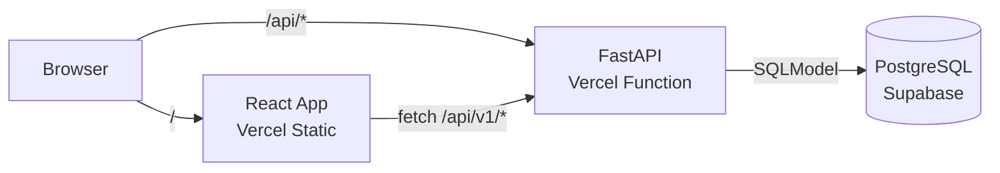
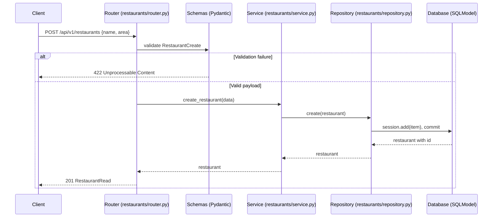
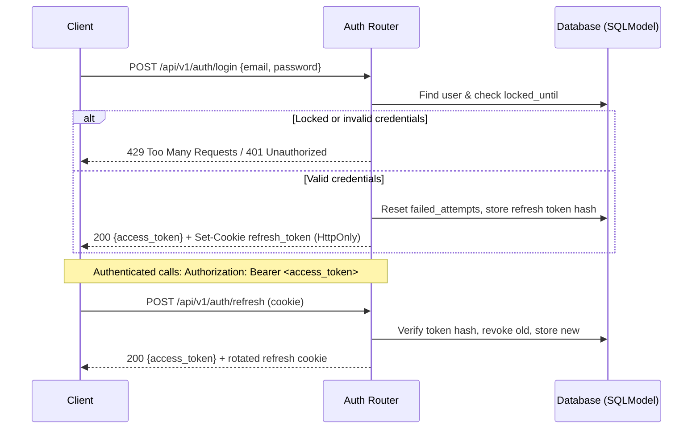
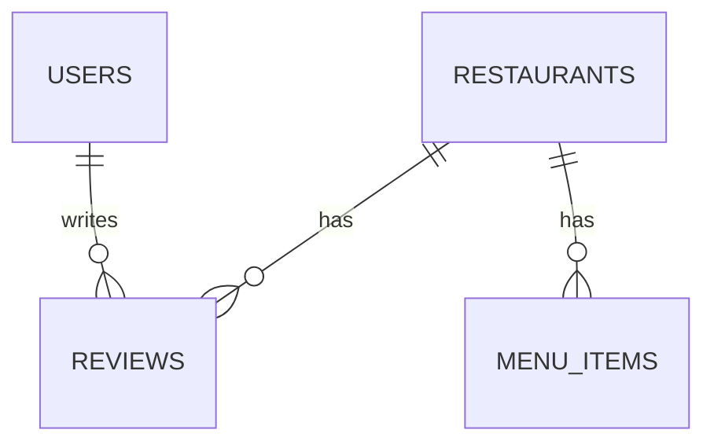
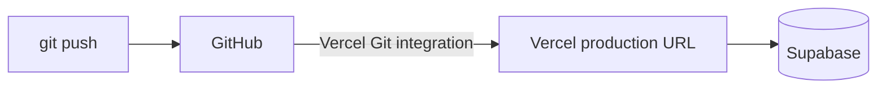

# Technical Design Document (TDD) — Petuk

| Field | Value |
|---|---|
| Product | Petuk |
| Version | MVP + Beta |
| Releases | MVP — Mid-term, Beta — Final |
| Status | Draft |
| Related docs | [Product Requirements Document (PRD)](01-prd.md), [Software Requirements Specification (SRS)](02-srs.md) |

**Documents in this set**

| Short form | Full form | Purpose | File |
|---|---|---|---|
| PRD | Product Requirements Document | What we build and why | [01-prd.md](01-prd.md) |
| SRS | Software Requirements Specification | Exact requirements and permissions | [02-srs.md](02-srs.md) |
| TDD | Technical Design Document | How we build it (this document) | [03-tdd.md](03-tdd.md) |

## 1. Introduction

This document explains how Petuk is built. Petuk is a restaurant discovery and review platform where diners rate restaurants in Bangladesh. The requirements are in the [SRS](02-srs.md).

## 2. Overview

* **MVP:** a FastAPI REST API for restaurant and review CRUD (with five-dimensional category ratings and calculated averages), stored in a PostgreSQL database through SQLModel, deployed together with the Vite + React frontend as one Vercel project.

* **Beta:** the same app gains user accounts and login (JWT), role-based access control (`customer`/`admin`), restaurant menu items with prices, review author ownership enforcement, and security hardening (Argon2 password hashing, 15-minute brute-force login lockout). Schema changes are managed with Alembic.

## 3. Tech stack

| Layer | Choice | Why | Release |
|---|---|---|---|
| API | FastAPI | Fast execution, built-in Pydantic validation, interactive OpenAPI docs (`/api/docs`), and native Python type hinting | MVP |
| ORM / models | SQLModel | Single class declaration acts as both SQLAlchemy table model and Pydantic schema; reduces boilerplate | MVP |
| Database (production) | PostgreSQL on Supabase | Managed cloud Postgres with table editor dashboard and built-in connection pooler (Supavisor) for serverless execution | MVP |
| DB driver | `psycopg[binary]` (psycopg 3) | Modern, robust PostgreSQL driver compatible with SQLModel and Supabase connection pooler | MVP |
| Database (local) | SQLite | Zero-configuration file-based database for rapid local development and testing | MVP |
| Frontend | Vite + React + TypeScript | Fast build tooling and typed component development for consumer-facing restaurant/review views | MVP |
| Hosting | Vercel | Monorepo deployment hosting frontend static assets and serverless Python backend API via `vercel.json` | MVP |
| Migrations | Alembic | Version-controlled schema evolutions as models migrate from MVP (restaurants, reviews) to Beta (users, menus) | Beta |
| JWT | PyJWT | Creation, signing, and verification of stateless JSON Web Tokens for authenticated sessions | Beta |
| Password hashing | `pwdlib[argon2]` | Industry-standard Argon2id password hashing algorithm recommended by modern security standards and FastAPI | Beta |

## 3. Architecture



`vercel.json` routes `/api/*` requests to the Python serverless backend and serves all other requests to the React frontend static build. For this reason, every backend route is prefixed with `/api/v1`, and API documentation is exposed at `/api/docs`:

```python
app = FastAPI(
    title="Petuk API",
    docs_url="/api/docs",
    openapi_url="/api/openapi.json",
    redoc_url=None,
)
```

### 3.1 Request flow — MVP:



### 3.2 Login, authentication, and role validation — Beta:



## 4. Project structure

```
backend/
  main.py              # creates the app, mounts routers, health check, global exception handlers
  app/
    config.py          # settings from env vars (DATABASE_URL; Beta: JWT secret, token expiry)
    database.py        # engine, get_session(), SessionDep, create_db_and_tables()
    security.py        # (Beta) password hashing (Argon2), JWT sign/verify, refresh token logic
    restaurants/       # domain module for restaurant management
      router.py        # /api/v1/restaurants endpoints
      schemas.py       # RestaurantCreate / RestaurantUpdate / RestaurantRead / RestaurantDetailRead
      models.py        # Restaurant table definition
      service.py       # RestaurantService: business logic & category average computations
      repository.py    # RestaurantRepository: database queries for restaurants
      dependencies.py  # valid_restaurant (resolves ID or 404), get_restaurant_service
    reviews/           # domain module for customer reviews & 5-star ratings
      router.py        # /api/v1/restaurants/{id}/reviews & /api/v1/reviews/{id} endpoints
      schemas.py       # ReviewCreate / ReviewUpdate / ReviewRead
      models.py        # Review table definition
      service.py       # ReviewService: score validation, one-review-per-customer rule (Beta)
      repository.py    # ReviewRepository: queries for reviews
      dependencies.py  # valid_review, get_review_service
    menus/             # (Beta) domain module for restaurant menu items
      router.py        # /api/v1/restaurants/{id}/menu & /api/v1/menu/{item_id} endpoints
      schemas.py       # MenuItemCreate / MenuItemUpdate / MenuItemRead
      models.py        # MenuItem table definition
      service.py       # MenuItemService: price checks and menu associations
      repository.py    # MenuItemRepository: queries for dishes/menu items
      dependencies.py  # valid_menu_item, get_menu_service
    auth/              # (Beta) router, schemas, models (AppUser, RefreshToken), service, dependencies
    users/             # (Beta) /api/v1/users/me (profile, password changes)
    admin/             # (Beta) /api/v1/admin/* (system-wide moderation & role assignment)
  alembic/             # (Beta) database migration scripts
  alembic.ini          # (Beta) Alembic configuration
  requirements.txt
frontend/
  src/
    App.tsx            # routes and global application shell
    pages/             # RestaurantListPage, RestaurantDetailPage, AboutPage (Beta: LoginPage, SignupPage, AdminPage)
    components/        # RestaurantCard, ReviewList, ReviewForm, RatingStars, MenuList
    layouts/           # AppLayout (navigation, search bar, user menu)
    services/          # api.ts (centralized fetch/axios HTTP calls)
    types/             # Restaurant, Review, MenuItem, User
    utils/             # formatters, BDT currency helpers, rating score validators
docs/
  01-prd.md
  02-srs.md
  03-tdd.md
```

The backend is organized by feature (domain), matching best practices for scalable FastAPI codebases: each domain directory contains its own router, schemas, models, service, repository, and dependencies.

- **Router:** Parses HTTP requests, validates path/query parameters, and delegates processing to the service.
- **Dependencies (`Depends`):** Performs reusable validations (e.g., verifying that a `restaurant_id` exists before proceeding or answering `404`), dependency injection for services, and role/token security checks in Beta.
- **Service:** Houses business rules (e.g., calculating the average scores across taste, atmosphere, cleanliness, price, and service, or preventing duplicate reviews per user) and remains decoupled from HTTP exceptions and SQL sessions.
- **Repository:** The only layer interacting directly with the database via the SQLModel session. If database access strategies change, only the repository is adapted while the service logic remains unaffected.
- **`main.py`:** Wires routers together, sets up `/api/docs` and `/api/health`, and registers the global `500` and validation error handlers.

## 5. Modules

| Module | What it does | Release |
|---|---|---|
| Restaurant | Add, view, list, edit, delete restaurants; shows average rating | MVP |
| Review | Add, view, edit, delete reviews with five ratings | MVP |
| Auth | Sign up, log in, log out | Beta |
| Menu | Menu items with prices for each restaurant | Beta |
| Admin | Admin manages restaurants and menus and deletes any review | Beta |

## 6. Data Model

| Table | Main fields | Release |
|---|---|---|
| `restaurants` | id, name, area, cuisine, address, created_at | MVP |
| `reviews` | id, restaurant_id, taste, atmosphere, cleanliness, price, service, comment, created_at | MVP |
| `users` | id, email, name, password_hash, role (`customer` / `admin`) | Beta |
| `menu_items` | id, restaurant_id, name, price | Beta |



## 7. REST API design

Base path: `/api/v1`. All bodies are JSON.

### 7.1 Endpoints — MVP:

In the MVP, no login is required. Any client can view, create, edit, and delete restaurants and reviews.

| Method | Path | Body | Success | Errors | FR |
|---|---|---|---|---|---|
| `POST` | `/api/v1/restaurants` | `RestaurantCreate` | `201` `RestaurantRead` | `422` | FR-01, FR-10 |
| `GET` | `/api/v1/restaurants?offset=0&limit=20` | — | `200` `RestaurantPage` | `422` | FR-02 |
| `GET` | `/api/v1/restaurants/{id}` | — | `200` `RestaurantDetailRead` | `404` | FR-03, FR-10 |
| `PATCH` | `/api/v1/restaurants/{id}` | `RestaurantUpdate` | `200` `RestaurantRead` | `404`, `422` | FR-04, FR-10 |
| `DELETE` | `/api/v1/restaurants/{id}` | — | `204` | `404` | FR-05 |
| `POST` | `/api/v1/restaurants/{id}/reviews` | `ReviewCreate` | `201` `ReviewRead` | `404`, `422` | FR-06, FR-10 |
| `GET` | `/api/v1/restaurants/{id}/reviews?offset=0&limit=20` | — | `200` `ReviewPage` | `404`, `422` | FR-07 |
| `PATCH` | `/api/v1/reviews/{id}` | `ReviewUpdate` | `200` `ReviewRead` | `404`, `422` | FR-08, FR-10 |
| `DELETE` | `/api/v1/reviews/{id}` | — | `204` | `404` | FR-09 |
| `GET` | `/api/health` | — | `200` `{"status":"ok"}` | — | FR-11 |

### 7.2 Endpoints — Beta:

"Who" maps to the roles defined in the [SRS permission matrix (section 3.4)](02-srs.md#34-permission-matrix). Reading restaurants, menus, and reviews remains public. State-modifying actions require an `Authorization: Bearer <access_token>` header (`401` if omitted or expired).

**Auth and profile**

| Method | Path | Who | Body | Success | Errors | FR |
|---|---|---|---|---|---|---|
| `POST` | `/api/v1/auth/signup` | Guest | `SignupRequest` | `201` `UserRead` | `409`, `422` | FR-12 |
| `POST` | `/api/v1/auth/login` | Guest | `LoginRequest` | `200` `TokenResponse` + cookie | `401`, `429` | FR-13, FR-19 |
| `POST` | `/api/v1/auth/refresh` | Refresh cookie | — | `200` `TokenResponse` + new cookie | `401` | FR-13 |
| `POST` | `/api/v1/auth/logout` | Refresh cookie | — | `204`, cookie cleared | — | FR-13 |
| `GET` | `/api/v1/users/me` | Customer / Admin | — | `200` `UserRead` | `401` | FR-14 |
| `PATCH` | `/api/v1/users/me` | Customer / Admin | `ProfileUpdate` | `200` `UserRead` | `401`, `422` | FR-14 |
| `POST` | `/api/v1/users/me/password` | Customer / Admin | `PasswordChange` | `204` (sessions revoked) | `400`, `401`, `422` | FR-14 |

**Restaurants (Protected in Beta)**

| Method | Path | Who | Body | Success | Errors | FR |
|---|---|---|---|---|---|---|
| `GET` | `/api/v1/restaurants` | Anyone | — | `200` `RestaurantPage` | `422` | FR-02 |
| `GET` | `/api/v1/restaurants/{id}` | Anyone | — | `200` `RestaurantDetailRead` | `404` | FR-03 |
| `POST` | `/api/v1/restaurants` | Admin | `RestaurantCreate` | `201` `RestaurantRead` | `401`, `403`, `422` | FR-16 |
| `PATCH` | `/api/v1/restaurants/{id}` | Admin | `RestaurantUpdate` | `200` `RestaurantRead` | `401`, `403`, `404`, `422` | FR-16 |
| `DELETE` | `/api/v1/restaurants/{id}` | Admin | — | `204` | `401`, `403`, `404` | FR-16 |

**Reviews (Protected in Beta)**

| Method | Path | Who | Body | Success | Errors | FR |
|---|---|---|---|---|---|---|
| `GET` | `/api/v1/restaurants/{id}/reviews` | Anyone | — | `200` `ReviewPage` | `404`, `422` | FR-07 |
| `POST` | `/api/v1/restaurants/{id}/reviews` | Customer / Admin | `ReviewCreate` | `201` `ReviewRead` | `401`, `404`, `409`, `422` | FR-14, FR-15 |
| `PATCH` | `/api/v1/reviews/{id}` | Author only | `ReviewUpdate` | `200` `ReviewRead` | `401`, `403`, `404`, `422` | FR-15 |
| `DELETE` | `/api/v1/reviews/{id}` | Author or Admin | — | `204` | `401`, `403`, `404` | FR-15, FR-17 |

**Menus (Beta)**

| Method | Path | Who | Body | Success | Errors | FR |
|---|---|---|---|---|---|---|
| `GET` | `/api/v1/restaurants/{id}/menu` | Anyone | — | `200` `MenuItemRead[]` | `404` | FR-18 |
| `POST` | `/api/v1/restaurants/{id}/menu` | Admin | `MenuItemCreate` | `201` `MenuItemRead` | `401`, `403`, `404`, `422` | FR-16, FR-18 |
| `PATCH` | `/api/v1/restaurants/{id}/menu/{item_id}` | Admin | `MenuItemUpdate` | `200` `MenuItemRead` | `401`, `403`, `404`, `422` | FR-16, FR-18 |
| `DELETE` | `/api/v1/restaurants/{id}/menu/{item_id}` | Admin | — | `204` | `401`, `403`, `404` | FR-16, FR-18 |

### 7.3 Examples:

**Create restaurant (MVP / Admin Beta):**

```http
POST /api/v1/restaurants
Content-Type: application/json

{
  "name": "Kacchi Bhai",
  "area": "Mirpur-10",
  "cuisine": "Biryani",
  "address": "Plot 11, Block D, Mirpur"
}
```

```http
201 Created

{
  "id": "e4c7a523-96e2-45e1-80a5-f1bf6cf52ba1",
  "name": "Kacchi Bhai",
  "area": "Mirpur-10",
  "cuisine": "Biryani",
  "address": "Plot 11, Block D, Mirpur",
  "created_at": "2026-11-03T10:00:00Z",
  "updated_at": "2026-11-03T10:00:00Z"
}
```

**Post a 5-dimension review (MVP / Customer Beta):**

```http
POST /api/v1/restaurants/e4c7a523-96e2-45e1-80a5-f1bf6cf52ba1/reviews
Content-Type: application/json

{
  "taste": 5,
  "atmosphere": 4,
  "cleanliness": 4,
  "price": 5,
  "service": 4,
  "comment": "Authentic Basmati Kacchi with tender mutton and generous aloo."
}
```

```http
201 Created

{
  "id": "9d1f8f3b-6382-4f74-8d4e-0a56e72b490f",
  "restaurant_id": "e4c7a523-96e2-45e1-80a5-f1bf6cf52ba1",
  "user_id": "b3c9a622-429b-449e-b153-e9185a3fa3b4",
  "taste": 5,
  "atmosphere": 4,
  "cleanliness": 4,
  "price": 5,
  "service": 4,
  "comment": "Authentic Basmati Kacchi with tender mutton and generous aloo.",
  "created_at": "2026-11-03T10:30:00Z",
  "updated_at": "2026-11-03T10:30:00Z"
}
```

**Get restaurant details with computed ratings (MVP / Beta):**

```http
GET /api/v1/restaurants/e4c7a523-96e2-45e1-80a5-f1bf6cf52ba1
```

```http
200 OK

{
  "id": "e4c7a523-96e2-45e1-80a5-f1bf6cf52ba1",
  "name": "Kacchi Bhai",
  "area": "Mirpur-10",
  "cuisine": "Biryani",
  "address": "Plot 11, Block D, Mirpur",
  "ratings": {
    "taste": 4.8,
    "atmosphere": 4.2,
    "cleanliness": 4.0,
    "price": 4.6,
    "service": 4.3,
    "overall": 4.38,
    "review_count": 28
  },
  "created_at": "2026-11-03T10:00:00Z",
  "updated_at": "2026-11-03T10:00:00Z"
}
```

**Log in (Beta):**

```http
POST /api/v1/auth/login
Content-Type: application/json

{
  "email": "customer@petuk.com",
  "password": "Password123"
}
```

```http
200 OK
Set-Cookie: refresh_token=...; HttpOnly; Secure; SameSite=Strict; Path=/api/v1/auth; Max-Age=604800

{
  "access_token": "eyJhbGciOi...",
  "token_type": "bearer",
  "expires_in": 900
}
```

### 7.4 Error format:

Use FastAPI's standard JSON format to eliminate custom error wrapper overhead:

```json
{
  "detail": "Restaurant not found"
}
```

Validation errors (`422`) use FastAPI/Pydantic's native format specifying the location and reason:

```json
{
  "detail": [
    {
      "loc": ["body", "taste"],
      "msg": "Input should be greater than or equal to 1 and less than or equal to 5",
      "type": "value_error"
    }
  ]
}
```

- A catch-all exception handler in `main.py` catches uncaught exceptions, returns `500` with `{"detail": "Internal server error"}`, and logs stack traces privately (NFR-06).
- Domain validation conflicts (e.g., submitting a duplicate review for the same restaurant in Beta) raise custom exceptions translated by FastAPI exception handlers into `409` with `{"detail": "You have already reviewed this restaurant"}`.
- Consecutive failed login attempts beyond the threshold raise `429` with `{"detail": "Account temporarily locked due to too many failed login attempts. Try again in 15 minutes."}`.

### 7.5 Design rules:

- Plural nouns for primary resources (`/restaurants`, `/reviews`, `/users`, `/menu`), verbs restricted to auth actions (`/auth/login`, `/auth/logout`, `/auth/refresh`).
- Nested paths indicate relationship and containment: `/restaurants/{id}/reviews` and `/restaurants/{id}/menu`.
- Direct ID paths are used for direct modification when ownership or primary resource context is established: `PATCH /api/v1/reviews/{id}` and `DELETE /api/v1/reviews/{id}`.
- `PATCH` applies partial updates; only provided fields in request payloads are updated (`model_dump(exclude_unset=True)`).
- Lists sort by `created_at` descending and enforce pagination parameters `offset` and `limit` (default: 20, max: 50). Responses use envelope schemas (`RestaurantPage`, `ReviewPage`) containing `items`, `total`, `offset`, and `limit`.
- `404 Not Found` is returned when a resource does not exist. `403 Forbidden` is returned when an authenticated user attempts an action outside their permissions (e.g., non-admin modifying a restaurant, or editing another user's review).
- Base prefix is `/api/v1` so subsequent schema iterations can version gracefully.

## 8. Configuration

| Variable | Local | Vercel | Release |
|---|---|---|---|
| `DATABASE_URL` | not set (SQLite default) | Supabase transaction pooler URL (port `6543`) | MVP |
| `POSTGRES_URL` | not set | Set by the Supabase integration on Vercel; used when `DATABASE_URL` is not set | MVP |
| `JWT_SECRET` | any long random string in `.env` | Random 32+ byte secret (`python -c "import secrets; print(secrets.token_urlsafe(48))"`) | Beta |
| `ACCESS_TOKEN_MINUTES` | `15` | `15` | Beta |
| `REFRESH_TOKEN_DAYS` | `7` | `7` | Beta |
| `MIGRATION_DATABASE_URL` | not needed | Not on Vercel. Used only on a developer machine to run Alembic against Supabase (session pooler, port `5432`) | MVP |

No secrets are committed to version control. The `.env` file remains listed in `.gitignore`.

Supabase setup (one time):
1. Create a project at supabase.com and store the database password safely.
2. Navigate to **Connect** -> **Transaction pooler** -> copy the connection URI, and update the scheme to `postgresql+psycopg://`.
3. In Vercel -> Project -> **Settings** -> **Environment Variables**, add the URI as `DATABASE_URL`.
4. Ensure `psycopg[binary]` is included in `backend/requirements.txt`.

Free-tier Supabase projects pause after one week without activity; check the Supabase dashboard and restore the instance before demonstrations or evaluation reviews.

## 9. Deployment


- The repository is linked to Vercel via the Vercel GitHub integration; every push to the `main` branch triggers an automated build and deployment to production.
- Production environment variables defined in section 8 are managed within the Vercel project dashboard.
- `vercel.json` defines a rewrite inside the frontend configuration routing non-file paths to `index.html`. This allows React Router to handle client-side routing (e.g., `/restaurants/:id`) without throwing Vercel 404 errors.
- Backend routing rules inside `vercel.json` send all `/api/*` calls directly to the FastAPI serverless function entry point (`backend/main.py`).
- Prior to deploying changes with schema alterations (Beta), execute `alembic upgrade head` from a local machine against the Supabase session pooler (`MIGRATION_DATABASE_URL`), then push the code to trigger deployment.

## 10. Security

- Passwords are hashed, never stored in plain text
- Input is validated on every request
- Permissions are checked on the server
- After 5 failed logins an account is blocked for 15 minutes
- Secrets are kept in environment variables, not in Git
- HTTPS is provided by Vercel

## 11. Risks

| Risk | Mitigation |
|---|---|
| Serverless cold starts cause elevated latency on initial requests | Acceptable for demo and grading context; verify performance criteria (NFR-03) on warm executions |
| Exhausting database connections due to concurrent Vercel serverless functions | Connect via Supabase transaction pooler (Supavisor, port `6543`) with `NullPool` configuration |
| Free-tier Supabase database automatically pauses after 7 days of inactivity | Inspect Supabase dashboard prior to milestone demos; any live API request wakes the instance |
| Code deployed to Vercel before database schema migration finishes | Run `alembic upgrade head` locally against Supabase before merging PRs; design migrations to be backward-compatible |
| JWT secret exposed or compromised | Store secrets strictly in Vercel environment variables; secret rotation invalidates existing tokens cleanly |
| Unauthorized modification of another user's review or admin-only resources | Centralize permission checks in FastAPI dependencies (`require_admin`, ownership validation); test directly against the [SRS permission matrix](02-srs.md#34-permission-matrix) |
| Missing automated test suite and CI pipeline | Perform manual verification for every endpoint against the [SRS acceptance criteria](02-srs.md#5-acceptance-criteria) before submission |
| Data loss or corruption during migration from demo MVP to Beta user-linked reviews | Mark MVP records as seed demo data (Assumption A-4); run data preparation scripts before applying foreign key constraints in Alembic |

## 12. Future Scope

- Restaurant owner accounts
- Search and filter by area or cuisine
- Photos on reviews
- Automated tests and CI/CD