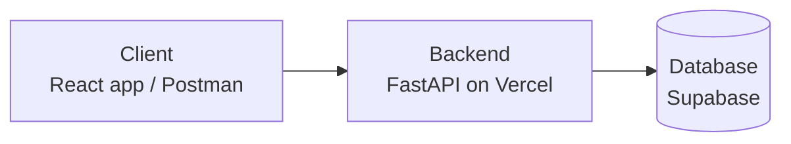
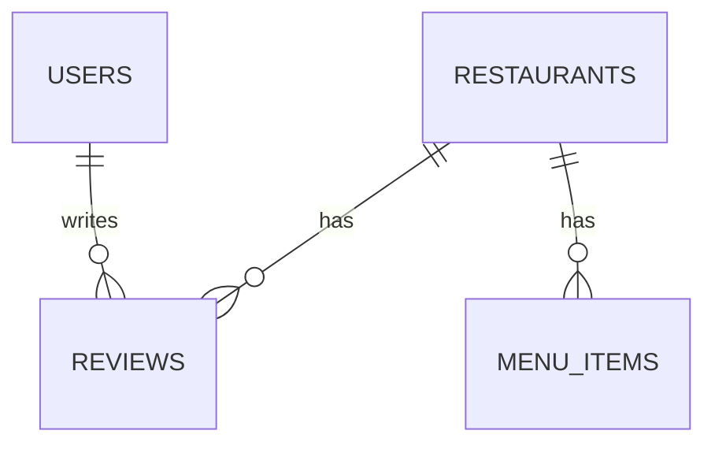

# Technical Design Document (TDD) — Petuk

| Field | Value |
|---|---|
| Product | Petuk |
| Version | MVP + Beta |
| Releases | MVP — Mid-term, Beta — Final |
| Status | Draft |
| Related docs | [Product Requirements Document (PRD)](01-prd.md), [Software Requirements Specification (SRS)](02-srs.md) |

**Documents in this set**

| Short form | Full form | Purpose | File |
|---|---|---|---|
| PRD | Product Requirements Document | What we build and why | [01-prd.md](01-prd.md) |
| SRS | Software Requirements Specification | Exact requirements and permissions | [02-srs.md](02-srs.md) |
| TDD | Technical Design Document | How we build it (this document) | [03-tdd.md](03-tdd.md) |

## 1. Introduction

This document explains how Petuk is built. Petuk is a restaurant discovery and review platform where diners rate restaurants in Bangladesh. The requirements are in the [SRS](02-srs.md).

## 2. System Overview

| Part | Technology |
|---|---|
| Frontend | React (simple page, optional) |
| Backend | Python, FastAPI |
| Database | PostgreSQL (Supabase) |
| Hosting | Vercel |

## 3. Architecture

The client sends a request, the backend checks it and talks to the database, and the backend sends a JSON response back.

## 4. Modules

| Module | What it does | Release |
|---|---|---|
| Restaurant | Add, view, list, edit, delete restaurants; shows average rating | MVP |
| Review | Add, view, edit, delete reviews with five ratings | MVP |
| Auth | Sign up, log in, log out | Beta |
| Menu | Menu items with prices for each restaurant | Beta |
| Admin | Admin manages restaurants and menus and deletes any review | Beta |

## 5. Data Model

| Table | Main fields | Release |
|---|---|---|
| `restaurants` | id, name, area, cuisine, address, created_at | MVP |
| `reviews` | id, restaurant_id, taste, atmosphere, cleanliness, price, service, comment, created_at | MVP |
| `users` | id, email, name, password_hash, role (`customer` / `admin`) | Beta |
| `menu_items` | id, restaurant_id, name, price | Beta |

## 6. Security

- Passwords are hashed, never stored in plain text
- Input is validated on every request
- Permissions are checked on the server
- After 5 failed logins an account is blocked for 15 minutes
- Secrets are kept in environment variables, not in Git
- HTTPS is provided by Vercel

## 7. Future Scope

- Restaurant owner accounts
- Search and filter by area or cuisine
- Photos on reviews
- Automated tests and CI/CD